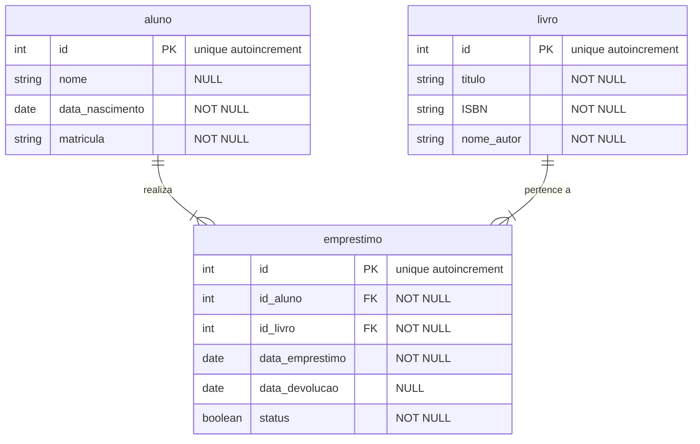

# Biblioteca Escolar:

---

### 1) A escola possui um sistema de biblioteca em que:
 - Alunos podem pegar livros emprestados.
 - Um livro pode ser emprestado várias vezes, mas um empréstimo registra apenas um livro e um aluno por vez.
### 2) Criar dicionário de dados das entidades existentes na modelagem.

---

