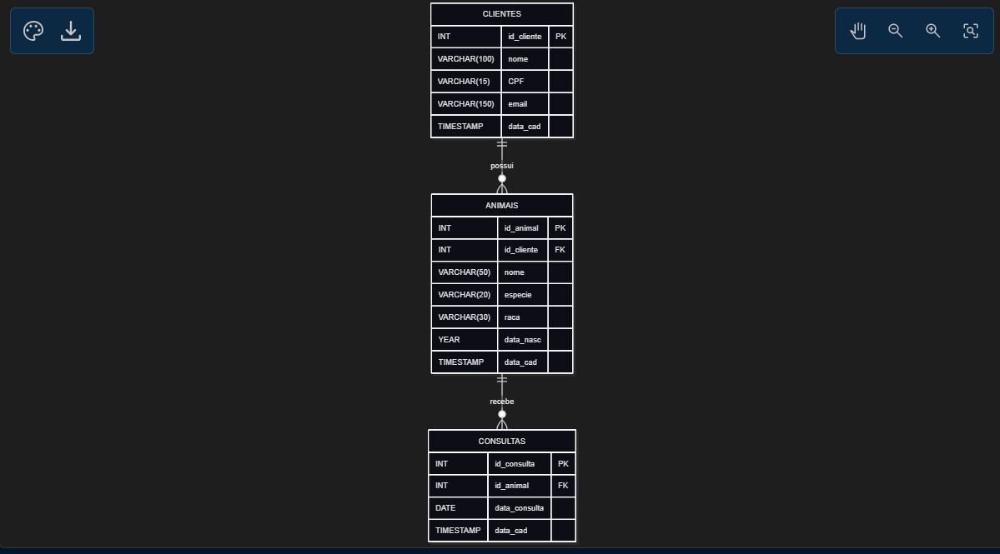

# diagrama 

# Dicionário de dados

## tabela cliente
### `clientes`

| Campo | Tipo | Chave | Obrigatório | Padrão / geração | Descrição |
|---|---|---|---|---|---|
| `id_cliente` | `INT` | PK | Sim | `AUTO_INCREMENT` | Identificador único do cliente. |
| `nome` | `VARCHAR(100)` | — | Não | `NULL` | Nome do cliente responsável pelos animais. |
| `CPF` | `VARCHAR(15)` | — | Não | `NULL` | Número do Cadastro de Pessoas Físicas do cliente. |
| `email` | `VARCHAR(150)` | — | Sim | — | Endereço de e-mail para contato com o cliente. |
| `data_cad` | `TIMESTAMP` | — | Sim | `CURRENT_TIMESTAMP` | Data e hora de cadastro do cliente. |

---

## tabela animais
### `animais`

| Campo | Tipo | Chave | Obrigatório | Padrão / geração | Descrição |
|---|---|---|---|---|---|
| `id_animal` | `INT` | PK | Sim | `AUTO_INCREMENT` | Identificador único do animal. |
| `id_cliente` | `INT` | FK | Não | `NULL` | Identificador do cliente responsável pelo animal; referencia `clientes.id_cliente`. |
| `nome` | `VARCHAR(50)` | — | Não | `NULL` | Nome do animal. |
| `especie` | `VARCHAR(20)` | — | Não | `NULL` | Espécie do animal, como cão ou gato. |
| `raca` | `VARCHAR(30)` | — | Sim | — | Raça do animal. |
| `data_nasc` | `YEAR` | — | Sim | — | Ano de nascimento do animal; o tipo `YEAR` armazena apenas o ano. |
| `data_cad` | `TIMESTAMP` | — | Sim | `CURRENT_TIMESTAMP` | Data e hora de cadastro do animal. |

---

## tabela consultas
### `consultas`

| Campo | Tipo | Chave | Obrigatório | Padrão / geração | Descrição |
|---|---|---|---|---|---|
| `id_consulta` | `INT` | PK | Sim | `AUTO_INCREMENT` | Identificador único da consulta. |
| `id_animal` | `INT` | FK | Não | `NULL` | Identificador do animal atendido na consulta; referencia `animais.id_animal`. |
| `data_consulta` | `DATE` | — | Não | `NULL` | Data da consulta veterinária. |
| `data_cad` | `TIMESTAMP` | — | Sim | `CURRENT_TIMESTAMP` | Data e hora de cadastro do registro da consulta. |
